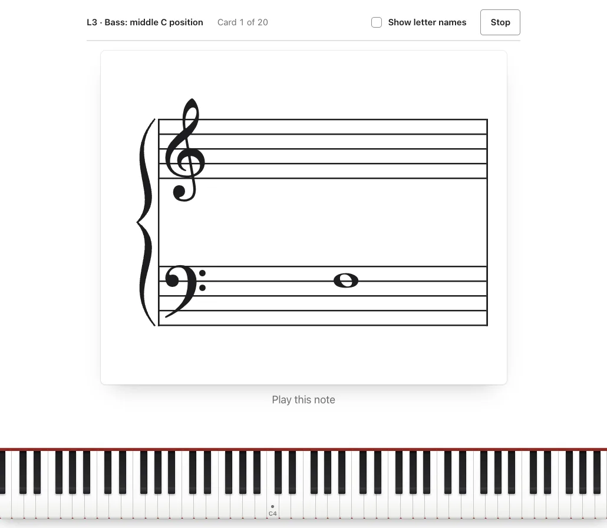
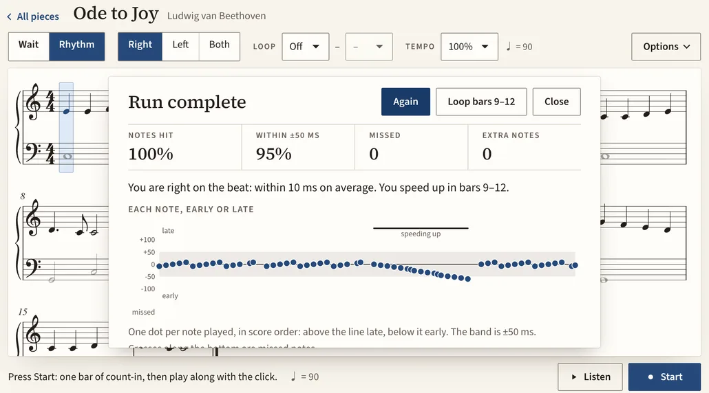
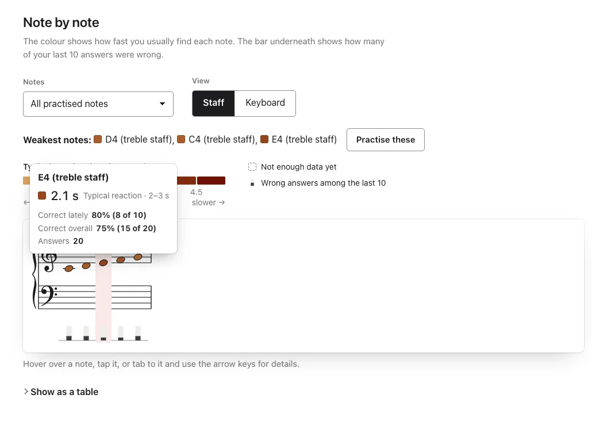

# dacapo

[简体中文](README.zh-CN.md) · [繁體中文](README.zh-TW.md) · [日本語](README.ja.md) ·
[한국어](README.ko.md)

[](https://github.com/ya-luotao/dacapo/actions/workflows/ci.yml)
[](LICENSE)
[](https://playdacapo.com/)

_Da capo_ — "from the beginning."

**Piano practice with a MIDI keyboard, on real notation.** dacapo drills reading on the grand
staff, times every answer, and keeps practising the notes, bars and scales that slow you down.
It runs in the browser, is free and open source, and keeps your data on your own device.

**[Open playdacapo.com →](https://playdacapo.com/)** Chrome or Edge on a computer, with a MIDI
keyboard over USB or your computer keys. Nothing to install, no account.

<p>
  
  
  
</p>

## What it does

- **Read.** One note at a time on a real grand staff, in graded levels; then intervals, key
  signatures, chords, rhythms tapped in time, and short music never seen before to sight-read.
  Every answer is timed, and the next card favours the ones you are slow on.
- **Pieces.** Thirty-one public-domain works from Initial to about grade 5, or your own
  MusicXML. The score waits for the right keys, or moves in time and shows where you rushed;
  loops, one hand at a time, a tempo ladder, memory mode and a review schedule.
- **Scales and technique.** Every scale and arpeggio with Hanon's fingering, and his exercises as
  printed, measured note by note for evenness in time, loudness and legato.
- **Ear and harmony.** Intervals, chords, melodies and rhythms by ear; chord symbols to play;
  progressions in any key; improvising over a backing.
- **A plan and a record.** Fifteen lessons for beginners, a plan for the day made from your own
  records, a weakness heatmap, a practice log, and assignments a teacher can send as a link.

Everything, practice by practice: [docs/FEATURES.md](docs/FEATURES.md).

## Principles

- **Real notation, not falling notes.** The point is to read music as it is printed: engraved
  with Verovio and VexFlow in the Bravura font.
- **Measured, then explained.** Advice after a run is made by rules from what was measured, and
  says why ([docs/ADVICE.md](docs/ADVICE.md)). Nothing is sent to a model.
- **Your data is yours.** Stored in your browser (IndexedDB), exported as a file whenever you
  like, synced between your own devices only if you sign in ([docs/SYNC.md](docs/SYNC.md)). The
  site counts visits without cookies; nothing about your practice leaves the device unasked.
- **Works without a network** once opened ([docs/OFFLINE.md](docs/OFFLINE.md)), and loads
  nothing from a CDN.
- **Five languages**, each with its own terms for the staff and the keyboard and its own fonts:
  English, 简体中文, 繁體中文, 日本語, 한국어.

## Requirements

- **Browser:** Chrome or Edge on desktop, for [Web MIDI](https://developer.mozilla.org/docs/Web/API/Web_MIDI_API).
  Other browsers work with the computer keyboard or the on-screen piano.
- **MIDI keyboard:** recommended, not required. One with fewer than 88 keys works: say which
  keys it has under Settings → Sound → Your keyboard.
- **Sound:** your instrument plays over MIDI, or the built-in sampled grand (Salamander Grand
  Piano) when it has no MIDI output. Avoid Bluetooth headphones: their delay varies too much to
  calibrate.

## Status

Version 0.2.0. Everything above is built, tested and live; [CHANGELOG.md](CHANGELOG.md) lists
each release. Known limitations:

- What is judged from loudness, the pedal and how long a key is held uses provisional thresholds,
  until they are set from runs recorded on real instruments.
- The Japanese, Korean and Traditional Chinese texts await review by native speakers.
- The Apple app ([docs/APPLE.md](docs/APPLE.md)) is built from the same code and is not in the
  App Store yet.

What is open is listed with each specification in `docs/` (its Status line and its
Clarifications). Bug reports are welcome.

## Development

You need [Node.js](https://nodejs.org/) 22.13 or newer (the CI uses the version in `.nvmrc`)
and [pnpm](https://pnpm.io/). The pnpm version is pinned in `packageManager` in `package.json`;
install that version with `npm install -g pnpm@10.34.5`, or let
[Corepack](https://nodejs.org/api/corepack.html) pick it up if you have it enabled.

```sh
pnpm install
pnpm dev
```

Then open the URL Vite prints (usually http://localhost:5173).

### Scripts

| Script              | What it does                                           |
| ------------------- | ------------------------------------------------------ |
| `pnpm dev`          | Start the dev server with hot reload                   |
| `pnpm build`        | Type-check and build for production into `dist/`       |
| `pnpm preview`      | Serve the production build locally                     |
| `pnpm typecheck`    | Run the TypeScript compiler without emitting           |
| `pnpm lint`         | Run ESLint                                             |
| `pnpm format`       | Format all files with Prettier                         |
| `pnpm format:check` | Check formatting without writing                       |
| `pnpm test`         | Run the unit tests once with Vitest                    |
| `pnpm check`        | Typecheck, lint, test and build — run this before a PR |

The app uses hash-based routes (`/#/read`), so the `dist/` folder can be served by any
static file host without rewrite rules. To serve it below the site root, build with the path in
`BASE_PATH`, for example `BASE_PATH=/dacapo/ pnpm build`. The build also writes `sw.js`, the
worker that keeps the app on the device ([docs/OFFLINE.md](docs/OFFLINE.md)): serve it without
caching, so that a new release reaches browsers at their next visit. The official site,
[playdacapo.com](https://playdacapo.com/), is `pnpm build:site` served by a Cloudflare Worker
(`wrangler.jsonc`), deployed by Cloudflare Workers Builds on every push to `main`.

## Contributing

Contributions of every size are welcome, and several need no programming:

- **Encode a public-domain piece** for the library (Beyer, Czerny, Gurlitt, Burgmüller …): the
  tools in `scripts/pieces/` check every note against an independent source. Open a
  [piece request](https://github.com/ya-luotao/dacapo/issues/new?template=piece_request.yml)
  first.
- **Proofread a built-in piece** against its public-domain scan.
- **Review a translation** in a language you speak natively, or add a new one — see
  [docs/TRANSLATING.md](docs/TRANSLATING.md) and open a
  [translation issue](https://github.com/ya-luotao/dacapo/issues/new?template=translation.yml).
- **Report what breaks** with your browser and MIDI keyboard.

Issues labelled
[good first issue](https://github.com/ya-luotao/dacapo/issues?q=is%3Aissue+is%3Aopen+label%3A%22good+first+issue%22)
are a good place to start. [CONTRIBUTING.md](CONTRIBUTING.md) has the setup and the rules, and
everyone takes part under the [Code of Conduct](CODE_OF_CONDUCT.md).

## License

[MIT](LICENSE)

Notation is drawn with [VexFlow](https://github.com/vexflow/vexflow) (MIT) and the
[Bravura](https://github.com/steinbergmedia/bravura) music font (SIL Open Font License 1.1) on the
Read page, and with [Verovio](https://www.verovio.org) (LGPL-3.0-or-later, shipped unmodified as
separate files) on the Pieces and Scales pages. The scale fingering and Hanon's technique
exercises (Nos. 1–20 and 42–53) are transcribed from _The Virtuoso Pianist_ (G. Schirmer, 1900;
public domain). Some built-in pieces are CC0 encodings
from the [PDMX](https://zenodo.org/records/15571083) dataset (CC BY 4.0). Everything is part of the
build, so the app never loads anything from a CDN. See [THIRD_PARTY_NOTICES.md](THIRD_PARTY_NOTICES.md)
for every licence and source.
